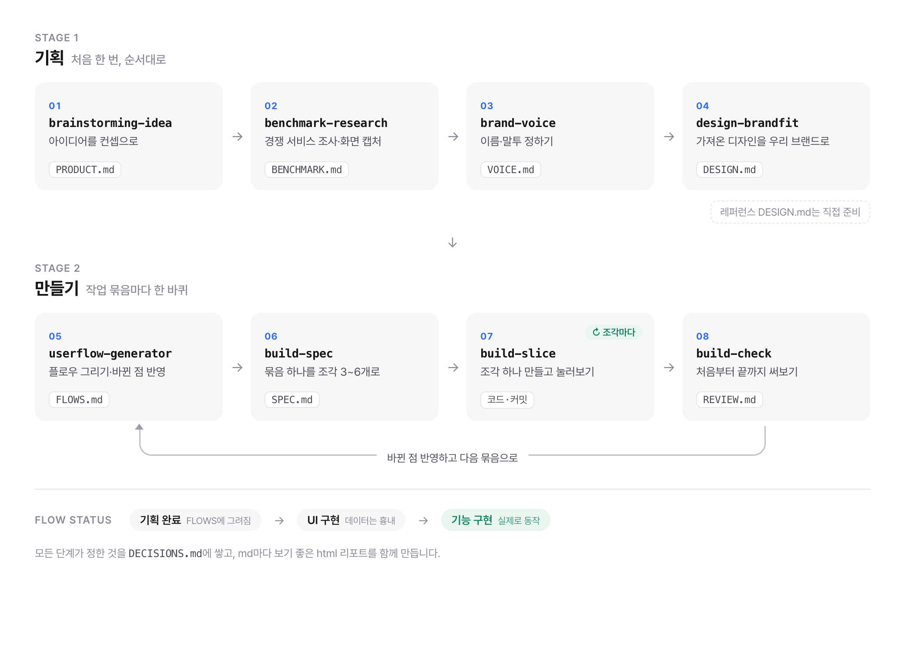

# vibe-studio

바이브 코딩으로 신규 서비스를 기획하고 만드는 Claude Code / Codex 플러그인.

> 기존 [vibe-ux-skills](https://github.com/tendtoyj/vibe-ux-skills)(vibe-ux · vibe-build)의 통합 개편 버전입니다.

## 한눈에 보기

기획 스킬로 서비스의 뼈대를 한 번 잡고, 그다음부터는 플로우 하나마다 만들기 고리를 한 바퀴씩 돕니다.

<picture>
  <source media="(prefers-color-scheme: dark)" srcset=".github/readme/overview-dark.png">
  
</picture>

## 설치

### Claude Code

```
/plugin marketplace add tendtoyj/vibe-studio
/plugin install vibe-studio@vibe-studio
```

### Codex

Codex CLI에서 marketplace를 추가한 뒤 `/plugins`에서 `vibe-studio`를 설치합니다.

```
codex plugin marketplace add tendtoyj/vibe-studio
codex
/plugins
```

Codex app에서는 Plugins에서 추가된 marketplace를 열고 `Vibe Studio`를 설치합니다. 설치 후 새 thread에서 사용하는 것을 권장합니다.

## 기획 흐름

| 순서 | 스킬 | 만드는 파일 (`docs/`) |
|:---:|---|---|
| 1 | `brainstorming-idea` | `PRODUCT.md` — 컨셉·문제·타깃·핵심 기능 |
| 2 | `benchmark-research` | `BENCHMARK.md` + `images/` — 경쟁사 리서치와 핵심 경쟁 화면 캡처. 결론은 `PRODUCT.md`의 포지셔닝 칸에 |
| 3 | `brand-voice` | `VOICE.md` — 확정 이름·보이스·톤 |
| 4 | `design-brandfit` | `DESIGN.md` — 가져온 레퍼런스 DESIGN.md를 우리 브랜드로 (레퍼런스는 직접 준비) |
| 5 | `userflow-generator` | `FLOWS.md` — 첫 방문(온보딩)·다시 오기 두 뼈대 위에 기능 플로우와 기본 장치(로그인 등)를 얹은 플로우 지도 + F1 첫 방문을 화면·상태·예외까지. 개발하면서 다시 불러 플로우를 하나씩 추가·갱신 |

- 단계마다 md와 함께 보기 좋은 html 리포트를 `docs/report/`에 만듭니다. `docs/report/index.html`을 열고 왼쪽 사이드바로 문서 사이를 오갈 수 있습니다.
- 모든 단계는 사용자가 정한 것을 `DECISIONS.md`에 한 줄씩 쌓습니다. 다음 단계는 이 기록을 읽고 이미 정한 것을 다시 묻지 않습니다.

## 만들기 흐름

만들기는 작업 묶음 하나 단위로 도는 고리입니다. 플로우를 그리고, 쪼개고, 만들고, 써보고, 바뀐 걸 반영한 뒤 다음으로 넘어갑니다. 묶음은 보통 플로우 하나지만, 흉내를 진짜로 바꾸기·스택 옮기기처럼 여러 플로우에 걸치거나 플로우와 무관한 일도 묶음 하나가 됩니다.

| 스킬 | 만드는 것 |
|---|---|
| `build-spec` | `build/SETUP.md` + `build/{NN-이름}/SPEC.md` — 스택(프로토타입은 Vite, 실제 기능은 Next.js)·데이터 방식·첫 버전에서 흉내 낼 기능을 SETUP에 정하고, 부를 때마다 작업 묶음 폴더를 하나 만들어 눌러볼 수 있는 조각 3~6개와 확인 기준을 적음 |
| `build-slice` | 코드와 커밋 + `build/LOG.md` — 묶음의 조각 하나를 DESIGN.md의 모습과 VOICE.md의 문구로 만들고, 브라우저에서 확인 기준을 눌러본 뒤 저장. "이상해요"(고치기)와 "되돌려줘"(되돌리기)도 여기서 |
| `build-check` | `build/{NN-이름}/REVIEW.md` + `shots/` — 묶음의 플로우를 사용자처럼 처음부터 끝까지 써보고 막힘·어긋남·위험(키 노출, 보안 설정)만 스크린샷과 함께 정리. 달라진 점은 userflow-generator로 넘김 |

- 폴더 구조:

  ```
  docs/
  ├─ PRODUCT.md  BENCHMARK.md  VOICE.md  DESIGN.md  FLOWS.md  DECISIONS.md
  ├─ report/     사람이 보는 html (index.html부터)
  ├─ images/     벤치마크 화면 캡처
  └─ build/      SETUP.md · LOG.md · 01-f1-first-visit/ · 02-f1-real/ …
  ```

- 플로우 상태는 `기획 완료` → `UI 구현`(화면은 있고 데이터는 흉내) → `기능 구현`(실제로 동작)으로 올라갑니다. 상태는 userflow-generator가 코드를 읽고 바꿉니다.

- 화면 확인은 Claude Code 데스크톱의 브라우저 창을 쓰면 가장 편합니다(build-slice가 첫 조각에서 `.claude/launch.json`을 만듭니다). 없으면 다른 브라우저 도구를 쓰거나, 체크리스트를 받아 직접 눌러봅니다.

## 사용

Claude Code에서는 네임스페이스와 함께 호출합니다.

```
/vibe-studio:brainstorming-idea
/vibe-studio:benchmark-research
/vibe-studio:brand-voice
/vibe-studio:design-brandfit
/vibe-studio:userflow-generator
/vibe-studio:build-spec
/vibe-studio:build-slice
/vibe-studio:build-check
```

Codex에서는 `$brainstorming-idea`처럼 `$`로 개별 스킬을 부르거나, "서비스 아이디어 잡아줘", "유저 플로우 그려줘", "이제 만들어보자", "다음 조각 만들어줘", "이상해요", "다 만들었어 써봐줘"처럼 자연어로 요청하면 해당 스킬이 트리거됩니다.

## 라이선스

[MIT](./LICENSE)
